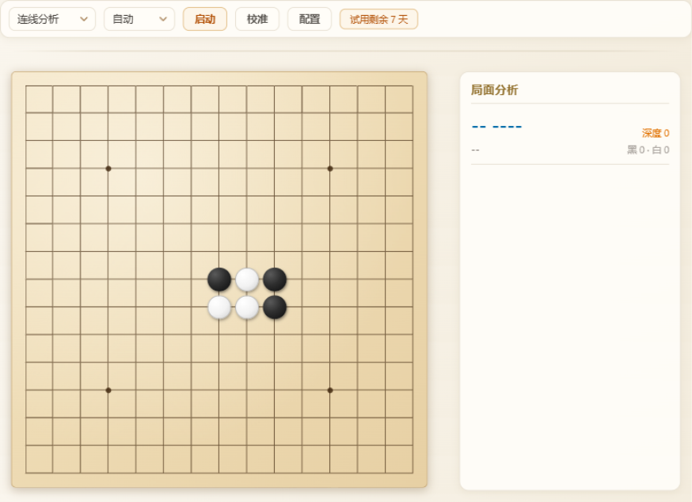

# 五子棋学习助手（wzqlink）🚩

基于 [Rapfi](https://github.com/dhbloo/rapfi) 引擎的五子棋学习工具：实时监听屏幕中的对局窗口，自动识别棋盘局面，AI 分析并给出建议招法。

架构与 [chessboard（中国象棋学习助手）](https://github.com/zengsheng-git/chessboard) 一致，将引擎（Pikafish → Rapfi）、棋盘模型（YOLO → 传统 CV 校准采样）替换为五子棋版本。

## 🖼 界面预览



*左：镜像棋盘实时同步对局（红框 = 引擎建议落点，蓝框 = 对手最新落点）· 右：局面分析与思考日志*

## 下载安装

👉 [点击下载最新版](https://github.com/zengsheng-git/gomoku/releases/latest)

| 版本 | 说明 |
|---|---|
| **免费试用** | 安装即用，**7 天全功能免费体验**，无需注册 |
| **授权版 ¥9.9** | 一次购买**永久激活**，解锁全部棋力 |

试用结束后仍可永久免费使用小白档（固定深度 1）；如需解锁全部棋力，微信扫码联系开发者获取授权码。

## 功能

- **连线分析**：选择对弈平台的窗口，自动截图识别 15×15 棋盘，镜像显示局面
- **引擎分析**：Rapfi（Gomocup 冠军级引擎）给出最优招法、评分、深度与次优候选
- **棋盘校准**：首次使用时在窗口截图上点击两个交叉点即可完成校准，无需训练模型
- **引擎配置**：深度 / 时间 / 线程 / 哈希 / 候选招数 / 次优分差 / 对局规则（自由 / 标准 / 连珠）
- **执子设置**：设置后分析面板按"我方 / 对方"标注并按我方利益着色，不设置则按行棋方视角中性显示

## 🚀 快速上手

三步开始：**① 点"启动" → ② 选择对弈窗口（首次需先校准） → ③ 看提示**。

图文详解见 **[《三分钟上手》](./docs/quick-start.md)**。

## 从源码运行

环境要求：Node.js、pnpm、Rust 工具链、WebView2 Runtime（Windows 11 自带）。

```powershell
pnpm install
pnpm tauri dev
pnpm tauri build --config server/tauri.windows.conf.json
```

产物：`server\target\release\bundle\msi\wzqlink_0.1.0_x64_en-US.msi`。

## 📜 许可说明

1. 本项目基于 Apache-2.0 许可证（[LICENSE](./LICENSE)），仅供学习与研究使用。
2. 引擎 [Rapfi](https://github.com/dhbloo/rapfi) 采用 **GPL v3** 协议，随应用分发时需遵循 GPL 要求开源或单独提供引擎。
3. 应用内置授权机制: 首次运行提供 7 天全功能试用, 之后未激活仅保留小白档（固定深度 1 提示）, 输入授权码解锁全部功能。
4. 严禁二次销售、未经授权的商业化或非法用途。
5. 使用本工具时，请遵守各平台用户协议，本工具不涉及任何破解或自动化操作。
6. 授权码的签发、密钥管理与安全边界见 [docs/license.md](./docs/license.md)（开发者文档）。
