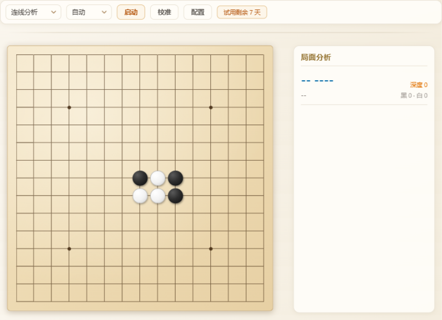

# 三分钟上手 🚩

从下载到看到第一个建议落点，只需要三步。

## 第 0 步：下载安装

👉 [点击下载最新版](https://github.com/zengsheng-git/gomoku/releases/latest)。

双击安装即可，无需其他环境。首次启动后自动开始 **7 天全功能免费试用**：

> 工具栏上的"试用剩余 7 天"标签就是授权入口，随时可查看状态或激活。

## 第 1 步：校准棋盘（仅首次需要）

点击工具栏 **"校准"** → 选择你的对弈窗口 → 在截图上**点击棋盘左上角交叉点**和**右下角交叉点** → 确认校准。

校准信息会保存，之后无需重复（对弈平台窗口布局变化时重新校准一次即可）。

## 第 2 步：点"启动"，选择对弈窗口

点击 **"启动"** → 弹出窗口选择器 → **选中对弈窗口** → 确定。工具开始监听，按钮变为红色"停止"。

## 第 3 步：看提示，下棋 / 复盘

- **左侧镜像棋盘**实时同步对弈局面
- **红框** = 引擎建议落点，**蓝框** = 对手最新落点，**紫色框** = 次优候选落点
- **右侧"局面分析"面板**：推荐招法、行棋方视角评分（可设置执子后按"我方 / 对方"着色）、深度、思考日志
- 对局规则可在配置抽屉切换（自由 / 标准 / 连珠禁手）

## ⚙️ 常用配置

| 配置项 | 说明 |
|---|---|
| 深度 / 时间 | 引擎思考深度与用时 |
| 线程 / 哈希 | 引擎算力（修改后自动重启引擎） |
| 候选招数 | 同时给出几条备选落点（1~5） |
| 次优分差 | 次优候选与最优的分差过滤 |
| 对局规则 | 自由规则 / 标准规则 / 连珠(禁手) |

## ❓ 常见问题

**Q: 试用期结束后还能用吗？**
可以。永久免费保留小白档（固定深度 1 的提示），随时可激活恢复全部功能。

**Q: 授权码怎么获取？多少钱？**
点击工具栏授权标签 → 微信扫码联系开发者。**授权价 ¥9.9，一次购买永久激活**。

**Q: 换电脑 / 重装系统后需要重新激活吗？**
已激活的授权码可以直接再次输入（激活记录保存在本机配置文件中，重装系统后重新粘贴原授权码即可）。

**Q: 识别不准 / 校准失败？**
确认对弈窗口未被遮挡、棋盘完整可见；重新执行一次校准（两个交叉点点准）通常即可解决。

---

微信扫码联系开发者（购买授权 / 反馈问题）：

